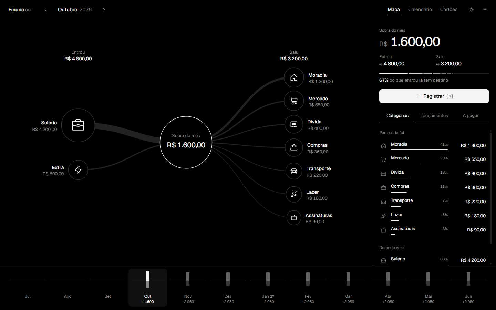

<p align="center">
  
</p>

<h1 align="center">Financ.co</h1>

<p align="center">
  <b>O dinheiro do mês num mapa só: o que entrou, o que sobrou e para onde foi.</b><br>
  Controle pessoal de ganhos, gastos, cartões e contas a pagar. App de mesa para Windows, 100% offline.
</p>

<p align="center">
  
  
  
  
</p>

<p align="center">
  
</p>

---

## ✨ O que ele faz

- 🗺️ **Mapa vivo do mês** — o que entrou, a sobra no centro e cada categoria de gasto saindo dela. Clicar numa categoria filtra os lançamentos.
- 📈 **Linha do tempo de 12 meses** — a sobra de cada mês, inclusive dos que ainda vão chegar (parcelas e contas fixas já entram na conta).
- 💳 **Cartões** com dia de fechamento e vencimento. O gasto no cartão conta no mês em que a fatura vence.
- 🔁 **Parcelado e "repete todo mês"** — lança uma vez e ele espalha pelos meses certos.
- 📅 **Calendário e A pagar** — o que vence em cada dia, com as contas atrasadas em destaque.
- 🧠 **Lembra a categoria pelo nome** do lançamento.
- ↩️ **Editar e desfazer** qualquer lançamento.
- 🌗 **Tema claro e escuro**, visual minimalista: uma tinta só, cor apenas no que entra (verde) e no que está negativo ou atrasado (vermelho).
- 💾 **Cópia diária automática** dos dados (guarda as 30 últimas).

## 🚀 Instalar

1. Baixe o repositório (**Code → Download ZIP**) e extraia.
2. Rode `python empacotar.py` para montar o pacote, ou use direto a pasta `instalador/` junto com `app.py` e `web/`.
3. Dê dois cliques em **Instalar.bat**. Se o PC não tiver Python, ele instala pelo winget.
4. Abra pelo atalho **Financ.co** da área de trabalho ou do menu Iniciar.

O programa vai para `%LOCALAPPDATA%\Financ.co` e aparece em *Aplicativos instalados* do Windows. Para remover, **Desinstalar.bat**.

## 🛠️ Rodar a partir do código

```bash
pip install pywebview pywin32
pythonw app.py
```

Só quer ver a tela? Abra `web/index.html?demo` no navegador: ele carrega dados de exemplo e não grava nada.

## 🗂️ Estrutura

```
app.py            janela (pywebview) e gravação dos dados
web/              a tela: index.html, app.js, estilo.css, ícones e fontes Geist
instalador/       Instalar.bat, Desinstalar.bat, instalador.py e LEIA-ME.txt
empacotar.py      monta o pacote de instalação e o Financ.co.zip
fazer_icone.py    desenha a logo (web/icone.ico e web/icone.png)
```

## 🔒 Privacidade

Os lançamentos ficam só no seu computador, em `dados/dados.json`. Nada é enviado para a internet, e a pasta `dados/` nunca entra no repositório nem no pacote de instalação.

## 🔭 Próximos passos

- 📱 Versão para iPhone (PWA)
- 🤖 Conselheiro financeiro com IA: a conta é feita pelo código, a IA explica, discorda quando precisa e fecha numa recomendação

---

<p align="center">Feito por <a href="https://github.com/Gusthavx">Gusthavo Silva</a></p>
